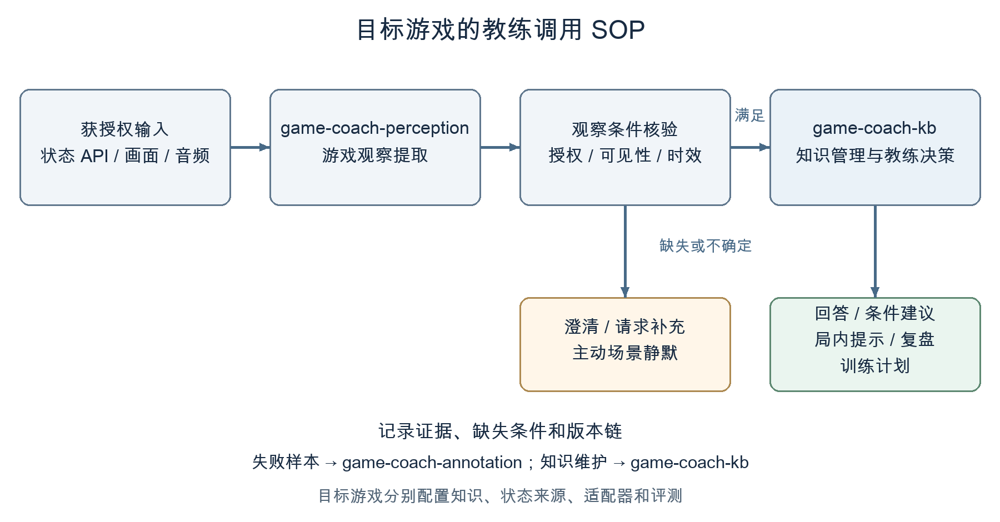
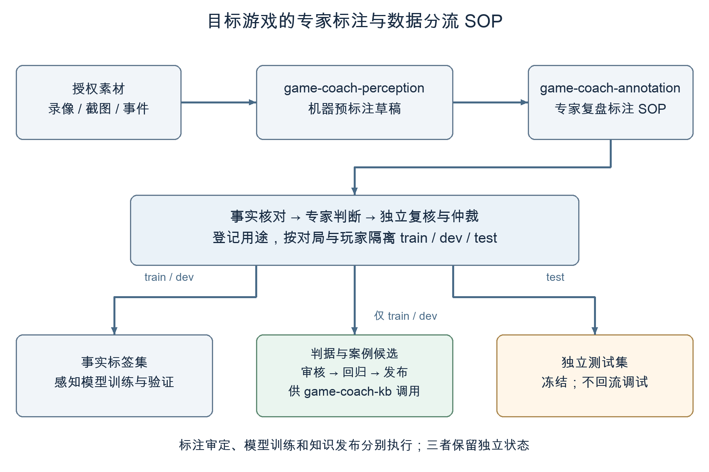

# Game Coach Skills

供游戏团队按需适配的 AI 教练 SOP，覆盖知识库管理与应用、观察提取和专家复盘标注。

本项目定义已有游戏知识库、教练 Agent 与专家复盘素材的使用流程。目标游戏需要分别补齐知识、术语、状态来源、适配配置和评测；“流程可复用”尚不代表已在多款真实游戏验证。交付包括三个可独立加载的 `SKILL.md`、结构化契约、虚构游戏示例与校验脚本；当前尚未接入真实游戏、训练模型或取得线上效果指标。

## 从这里开始

| 入口 | 解决的问题 |
| --- | --- |
| [game-coach-kb](game-coach-kb/SKILL.md) | 如何检索当前版本知识，核对策略前提并生成回答、复盘和训练计划 |
| [game-coach-perception](game-coach-perception/SKILL.md) | 如何将获授权的 API、画面和音频整理为带时间和出处的观察 |
| [game-coach-annotation](game-coach-annotation/SKILL.md) | 如何把事实标签与专家判断分开审定，制作训练、知识候选及评测资产 |
| [Word 调研与方案报告](docs/game-coach-skills-report.docx) | 公开产品调研、设计边界、专家生产流程与评测方法 |

## 线上教练如何使用知识



`game-coach-perception` 输出的是观察；`game-coach-kb` 还要结合已发布知识和专业判据验证建议是否适用。缺少关键状态时，系统澄清、给条件式建议或停止主动提示。每个游戏使用自己的实体、模式、状态字段与判据，核心流程不依赖王者荣耀术语。

## 专家怎样补强教练



`game-coach-annotation` 组织离线复盘标注，机器预标注保留草稿状态。专家先核对事实，再记录判断依据、适用条件、例外和分歧；拟发布判据及参考评测答案须独立复核。通过审核的标注也须按用途分流，模型训练与知识发布分别执行，独立测试数据保持冻结。

## 文件与契约

```text
game-coach-kb/          知识检索、教练决策、版本更新与评测
game-coach-perception/  多模态观察、时间定位、可见性与不确定性
game-coach-annotation/  事实核对、专家判断、审定与数据集隔离
docs/                  架构、公开调研、流程图与 Word 报告
validate_bundle.py     三包结构及共用观察契约检查
```

共用接口是 [`ObservationBundle`](game-coach-perception/schemas/observation-bundle.schema.json)，专家记录使用 [`AnnotationCase`](game-coach-annotation/schemas/annotation-case.schema.json)。这些 Schema 描述数据格式；权限、展示、训练和发布仍需宿主服务实现。

## 验证方法与当前结果

需要 Python 3，无第三方依赖：

```bash
python3 validate_bundle.py
```

目前通过的是包结构、示例引用、标注记录约束与跨包契约一致性检查。仓库准备了 45 条执行或质量场景、64 条触发场景；这些是模拟测试素材，尚未作为目标模型效果成绩。真实验收需分别测感知准确性、专家一致性与教练决策，再使用授权的真实对局做端到端评测。

可以先在 [架构说明](docs/architecture.md) 中看两条流程的交接，再按 [研究与参考资料](docs/research.md) 核对产品启发和证据等级。
